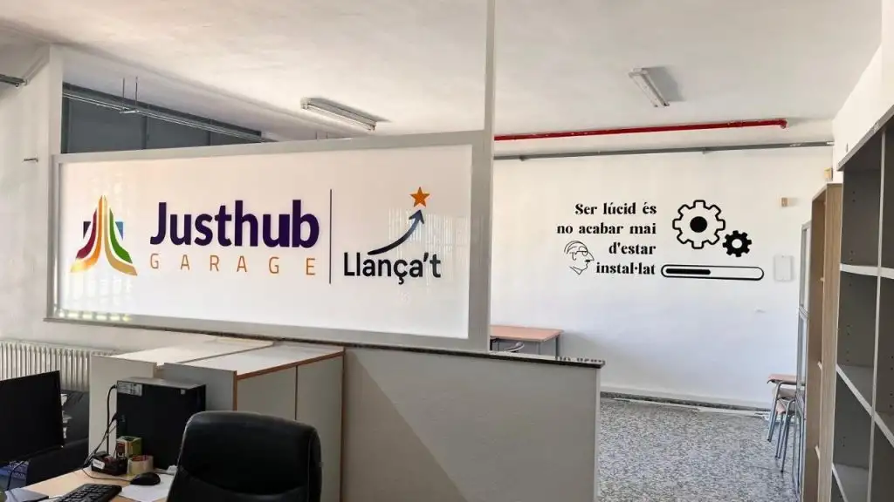
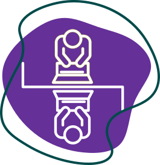
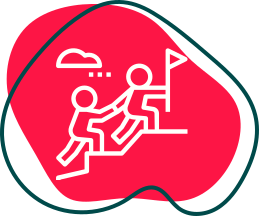
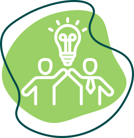

{.home-logo width="1080" height="209" fetchpriority="high"}

<section class="hero wrap" markdown="1">

VIVER D'EMPRESES · IES JAUME II EL JUST
{.eyebrow}

# Les grans idees necessiten un lloc on créixer.

T'acompanyem a transformar la teua idea en un projecte real, des de la Formació Professional.
{.lead}

[Conta'ns la teua idea ↗](https://forms.cloud.microsoft/e/SJm16cSgbt){.button .primary}
[Descobreix el Garage →](projecte.md){.text-link}

Tavernes de la Valldigna · Talent local, idees sense límits
{.location}

ESPAI PER A FER-HO POSSIBLE
{.visual-top}

{.space-photo width="1024" height="576" fetchpriority="high"}

El teu pròxim pas, **en bona companyia.**
{.visual-bottom}

EL GARAGE / EL NOSTRE PUNT DE TROBADA
{.photo-caption}

</section>

Una idea pròpia · Una xarxa compartida · Un futur per construir

<section class="section wrap about" markdown="1">

01 / EL PROJECTE
{.eyebrow}

## De l'aula al món real.

Us presentem el viver d'empreses de l'IES Jaume II El Just. Un espai per a connectar el que saps fer amb allò que vols crear.
{.intro}

Justhub Garage va nàixer el 2024 com un projecte d'innovació educativa del centre, i actualment es troba integrat en **Llança't**, el programa de la Generalitat Valenciana, cofinançat pel Fons Social Europeu, que ajuda a posar en marxa projectes emprenedors des dels centres d'FP.

Si estàs cursant un cicle o ja tens la titulació i una idea de negoci, ací trobaràs espai, orientació i persones amb qui avançar.

[Coneix el projecte →](projecte.md){.text-link}

</section>

<section class="services-section" markdown="1">

02 / QUÈ T'OFERIM
{.eyebrow}

## Recursos per a fer el següent pas.

{width="66" height="66" loading="lazy"}

### Espai de coworking

Un lloc al centre per a treballar, amb connexió a Internet i contacte amb altres persones emprenedores.

{width="66" height="66" loading="lazy"}

### Acompanyament personalitzat

Mentories amb especialistes del CEEI i assessorament tècnic per a impulsar el teu projecte.

{width="66" height="66" loading="lazy"}

### Formació i comunitat

Tallers, recursos digitals i connexió amb la xarxa de vivers i l'ecosistema emprenedor.

[Consulta tots els serveis →](serveis.md){.text-link}

</section>

<section class="news-section" markdown="1">

03 / LA VIDA AL GARAGE
{.eyebrow}

## Actualitat del projecte

Notícies, activitats i trobades publicades a la web de l'institut.

Carregant les notícies del projecte…

[Totes les notícies →](actualitat.md){.text-link}

<noscript>
Consulta les <a href="https://portal.edu.gva.es/iesjaumeeljust/category/justhub-garage/">notícies de Justhub Garage a PortalEdu</a>.
</noscript>

</section>

<section class="closing wrap" markdown="1">

JUSTHUB GARAGE | LLANÇA'T
{.eyebrow}

## El futur també es crea ací.

[Conta'ns el teu projecte →](participa.md){.button .primary}

</section>
