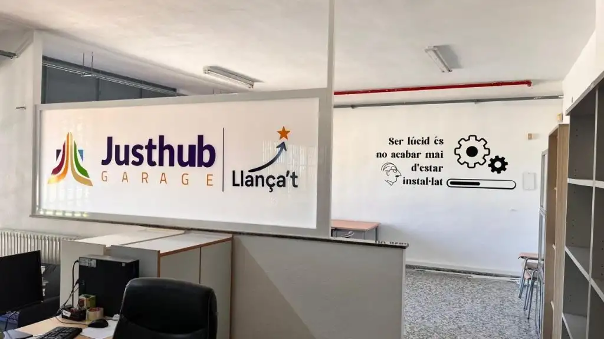

JUSTHUB GARAGE | LLANÇA'T
{.eyebrow}

# De l'aula al món real.

Som el viver d'empreses de l'IES Jaume II El Just, a Tavernes de la Valldigna. Acompanyem persones que volen convertir els seus coneixements d'FP en projectes emprenedors.
{.intro}

## El programa Llança't

[Llança't](https://ceice.gva.es/va/web/formacion-profesional/vivers-d-empresa) és un programa d'innovació educativa de la Generalitat Valenciana, cofinançat pel Fons Social Europeu. La seua finalitat és transformar els centres de Formació Professional en vivers d'empreses i ajuda a posar en marxa projectes emprenedors.

Al nostre centre, aquest programa es materialitza en **Justhub Garage**, que va començar com a projecte d'innovació del centre amb aquesta mateixa finalitat: donar continuïtat a les idees i als projectes que naixen a les aules.

## Un espai connectat amb el territori

Al Garage conflueixen les famílies professionals d'**Informàtica i Agrària**. Aquesta connexió permet compartir coneixements i explorar solucions tecnològiques vinculades amb les necessitats de l'entorn.

Però no només ens centrem en aquestes famílies professionals. Podeu participar al viver des de qualsevol familia professional. Si no és de la nostra especialitat, podem contactar amb els vostres centres quan necessitem ajuda més tècnica. La col·laboració entre centres, professionals i agents de l'ecosistema emprenedor ens ajuda a ampliar les possibilitats dels projectes.

{.editorial-photo width="1024" height="576"}

## A qui ens adrecem?

Si **estàs cursant un cicle de Formació Professional o ja has obtingut la titulació**, i tens una idea de negoci, aquest programa està pensat per a tu. Parlem del teu projecte i dels recursos que poden ajudar-te.

[Coneix els serveis →](serveis.md){.button .primary}
[Contacta amb nosaltres →](participa.md){.text-link}

## Més informació

- [El projecte a la web de l'institut](https://portal.edu.gva.es/iesjaumeeljust/justhub-garage/).
- [Xarxa de vivers d'empreses de la Generalitat Valenciana](https://ceice.gva.es/va/web/formacion-profesional/vivers-d-empresa).

