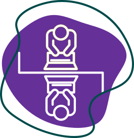
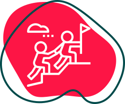
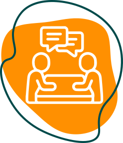
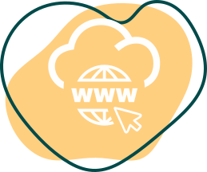
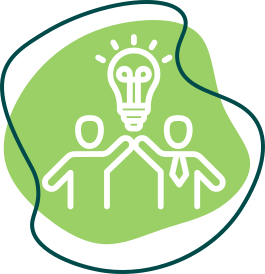
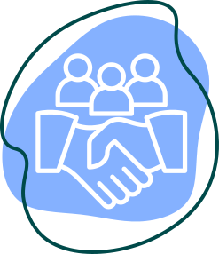

RECURSOS I ACOMPANYAMENT
{.eyebrow}

# Tu poses la idea. Fem camí amb tu.

Des de l'espai de treball fins a les connexions que necessites per a avançar.
{.intro}

{width="66" height="66"}

## Espai de coworking i d'incubació

Un espai al centre des d'on treballar i estar en contacte amb altres persones emprenedores de la zona, amb mobiliari de treball i connexió a Internet.

{width="66" height="66"}

## Mentories personalitzades

Mentories en línia amb especialistes del Centre Europeu d'Empreses Innovadores (CEEI) per a ajudar-te a impulsar el teu projecte.

{width="66" height="66"}

## Assessorament tècnic

Suport especialment en les famílies professionals del centre: Informàtica i Agrària. En altres especialitats, podem treballar conjuntament amb el teu centre de procedència.

{width="66" height="66"}

## Espai web i serveis al núvol

Espai per a crear la web o els serveis al núvol de la teua empresa. Si no disposes de coneixements tècnics, també et podem assessorar i ajudar en la creació de la teua presència digital.

{width="66" height="66"}

## Formació pràctica

Activitats i tallers periòdics orientats a l'emprenedoria, la creativitat i la projecció de la teua marca. Les persones participants del programa poden compartir aquestes activitats amb l'alumnat del centre.

{width="66" height="66"}

## Connexió amb l'ecosistema emprenedor

Connexió amb la resta de vivers i amb l'ecosistema emprenedor per a promoure sinergies, intercanviar idees i trobar col·laboracions.

[Parlem del teu projecte →](participa.md){.button .primary}

